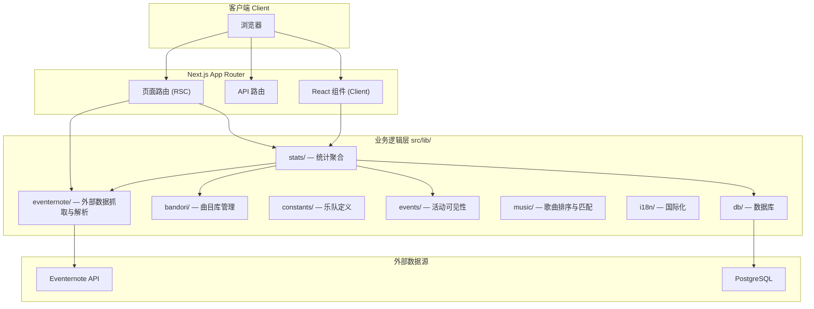
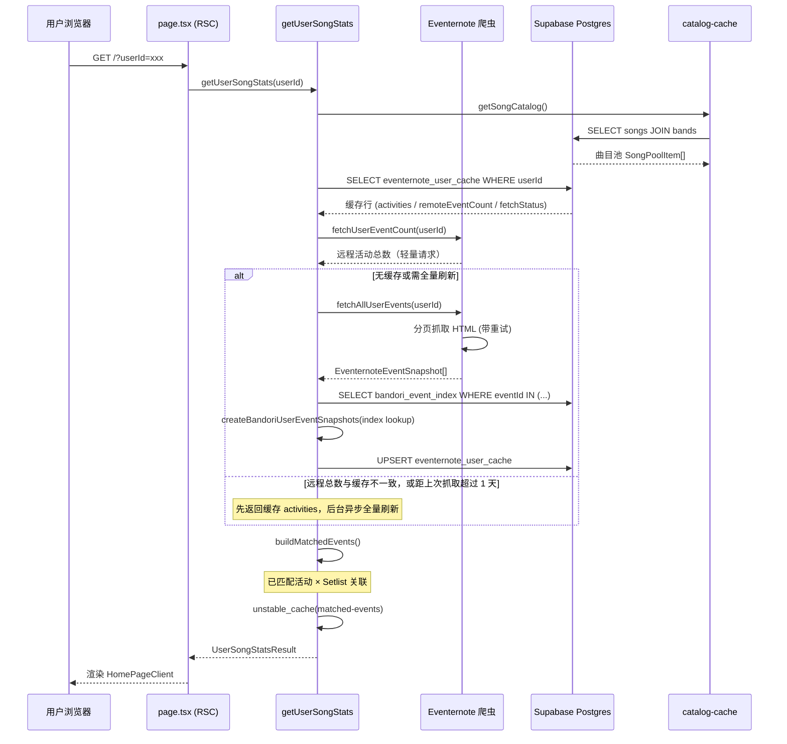
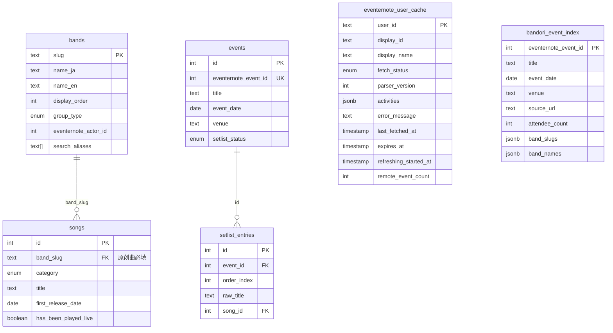
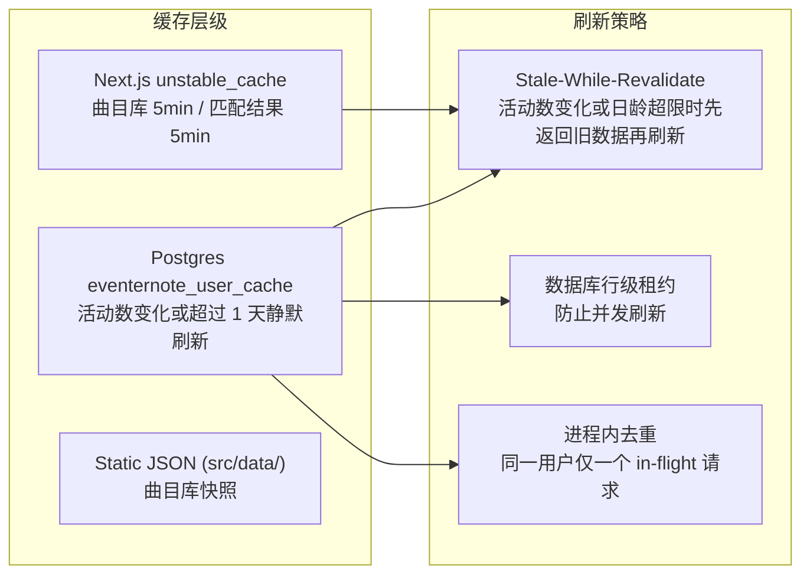
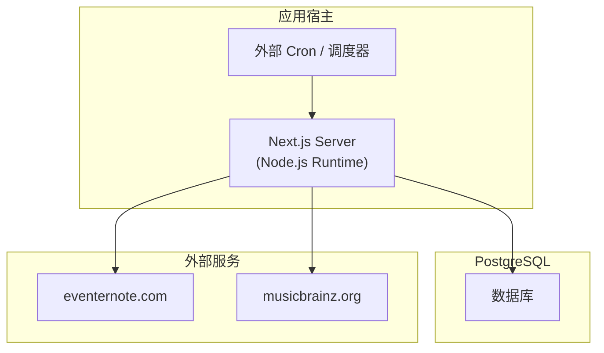

# BDR Events to Songs — 项目架构文档

## 1. 项目概述

**BanG Dream! Events to Songs** 是一个 Web 应用，用于查询用户在 [Eventernote](https://www.eventernote.com) 上参加过的 BanG Dream! 演出现场活动，并统计用户听过的歌曲覆盖情况。

核心功能：

- 输入 Eventernote 用户 ID，抓取该用户参加过的所有活动
- 匹配活动与 BanG Dream! 乐队，关联官方曲目库
- 统计每支乐队的歌曲听取覆盖率，展示已收录/缺失的 Setlist
- 按活动 ID、标题、日期及出演乐队混合检索 Setlist，并提供可分享的活动链接
- 通过独立用户/活动路径浏览最近活动、“历史上的今天”和自动识别的活动系列
- 展示独立的歌曲演出统计页与版本化开放 API
- 区分原创曲、翻唱曲和企划共通歌曲，Setlist 条目绑定歌曲 ID
- 支持简体中文、繁体中文、日语和英语
- 支持浅色、深色、跟随系统主题以及 JPEG 统计图导出
- 可通过 MusicBrainz 定时补充新曲并修正更早的发售日期

## 2. 技术栈

| 层级     | 技术                                |
| -------- | ----------------------------------- |
| 框架     | Next.js 16 (App Router, RSC)        |
| 语言     | TypeScript 5                        |
| UI       | React 19 + Tailwind CSS 4           |
| 数据库   | Supabase Postgres (via Drizzle ORM) |
| 爬虫解析 | Cheerio                             |
| 数据校验 | Zod 4                               |
| 测试     | Vitest (单元) + Playwright (E2E)    |
| 部署     | 任意 Node.js 托管平台               |

## 3. 顶层目录结构

```
bdr-events-to-songs/
├── src/
│   ├── app/                    # Next.js App Router 路由
│   ├── components/             # React 组件
│   ├── data/                   # 静态 JSON 数据
│   └── lib/                    # 核心业务逻辑
├── scripts/                    # 离线数据管理脚本
├── tests/                      # 单元测试
├── drizzle.config.ts           # Drizzle ORM 配置
└── vitest.config.mts           # Vitest 配置
```

## 4. 架构分层图



## 5. 核心数据流

以下是用户查询的完整数据流：



## 6. 模块详解

### 6.1 `src/app/` — 路由层

```
app/
├── page.tsx                          # 首页 (RSC) — 查询入口 + 数据预取
├── users/[userId]/page.tsx           # 可分享的用户统计路径
├── events/page.tsx                   # 活动搜索与最近活动
├── events/[eventId]/page.tsx         # 可分享的活动 Setlist 路径
├── songs/page.tsx                    # 歌曲演出统计
├── sitemap.ts / robots.ts            # 公开站点的爬虫元数据
├── api/page.tsx                      # 开放 API 说明页
├── layout.tsx                        # 根布局 — 字体、主题
├── globals.css                       # Tailwind 全局样式
├── api/
│   ├── song-events/route.ts          # 歌曲关联的活动列表 API
│   ├── user-refresh-status/route.ts  # 用户缓存刷新状态查询
│   ├── live-setlists/route.ts        # 活动 Setlist 模糊搜索
│   ├── openapi.json/route.ts         # OpenAPI 规范
│   ├── v1/                           # 版本化乐队、歌曲与活动 API
│   └── cron/
│       ├── event-ranking/route.ts    # 刷新 bandori_event_index
│       └── songs-sync/route.ts       # 同步 MusicBrainz 最近歌曲
└── admin/
    ├── band-search-aliases/           # 乐队检索等效关键词管理
    ├── list/                         # 管理后台 — 活动列表（查 index，年份/乐队复选）
    ├── recent/                       # 管理后台 — 近期活动（查 index）
    ├── rules/                        # 管理后台 — 活动可见性规则
    ├── songs-import/                 # 管理后台 — 歌曲导入、编辑与删除
    ├── setlist-import/               # 管理后台 — Setlist 导入/编辑
    └── user-cache/                   # 管理后台 — 用户缓存只读浏览
```

**`page.tsx`** 是核心入口，采用 RSC 模式在服务端完成全部数据查询后，将结果序列化传递给客户端组件 `HomePageClient`。

### 6.2 `src/components/` — UI 组件层

```
components/
├── home-page-client.tsx              # 首页客户端壳 — 状态管理、表单、结果展示
├── home/                              # 首页请求复用与用户统计会话缓存
├── results-client.tsx                # 结果展示主组件 — 组合布局
├── results/
│   ├── use-results-state.ts          # 结果页状态管理 Hook
│   ├── band-summary-card.tsx         # 乐队摘要卡片
│   ├── event-card.tsx                # 活动卡片
│   └── utils.ts                      # 共享工具函数
├── search-form.tsx                   # 搜索表单
├── live-setlist-search.tsx           # 标题、日期及出演乐队混合搜索
├── live-setlist-result.tsx           # Setlist、首次演唱标记及系列切换
├── recent-live-setlists.tsx          # 最近活动与“历史上的今天”列表
├── songs-stats-page-client.tsx       # 歌曲演出统计及完整曲库搜索
├── public-footer.tsx                 # API 与 GitHub 链接
├── locale-toggle.tsx                 # 语言切换
├── theme-toggle.tsx                  # 主题切换
├── save-image-button.tsx             # 导出 JPEG 图片
└── refresh-while-warming.tsx         # 缓存预热中的刷新组件
```

组件拆分策略：

- `results-client.tsx` 负责布局组合，从 `use-results-state` Hook 获取所有派生状态
- `BandSummaryCard` 和 `EventCard` 是纯展示组件，通过 props 接收数据
- 状态管理集中在 `use-results-state.ts`，包含筛选、展开、歌曲事件加载等逻辑

### 6.3 `src/lib/` — 业务逻辑层

#### 6.3.1 `stats/` — 统计聚合（核心业务）

```
stats/
├── get-user-song-stats.ts       # 缓存策略分支、查询和结果组装
├── catalog-cache.ts             # 曲目库缓存 (unstable_cache)
├── build-matched-events.ts      # 活动 × 乐队 × Setlist 匹配
├── aggregate.ts                 # 前端聚合逻辑 (纯函数)
├── eventernote-cache-policy.ts  # 缓存策略：活动数比对 / 日龄静默刷新 / 租约
├── user-events-cache-store.ts   # 缓存写入、失败恢复和数据库租约
├── user-events-refresh.ts       # 上游抓取、进程内去重和后台刷新
├── song-events-cache.ts         # 歌曲关联活动缓存
├── song-performance-stats.ts    # 完整曲库演出次数统计与搜索数据
└── refresh-song-live-state.ts   # 刷新歌曲现场演出状态
```

**`get-user-song-stats.ts`** 是统计入口；用户活动刷新与持久化分别由
`user-events-refresh.ts` 和 `user-events-cache-store.ts` 协调。数据库租约与进程内请求去重
构成两层独立保护，成功结果统一由入口组装。

核心职责：

1. 并行获取曲目库和用户缓存
2. 判断缓存状态（缺失 / 远程活动数变化 / 距上次抓取超 1 天 / 解析器版本过旧 / 手动刷新）
3. 决定是否触发后台刷新（`after()` 调度）
4. 调用 `buildMatchedEvents` 完成活动-歌曲匹配
5. 返回 `UserSongStatsResult` 联合类型

缓存策略（**非固定时间 TTL**；`expires_at` 列保留但当前写入为 `null`）：

- 每次查询先轻量请求 Eventernote 用户活动页，解析**远程活动总数** `remoteEventCount`，与库中 `eventernote_user_cache.remote_event_count` 比对。
- **总数相同且距上次抓取不足 1 天**：视为缓存仍有效，直接返回已存 `activities`。
- **总数相同但距上次抓取超过 1 天**：立即返回旧 `activities`，并静默后台全量刷新。
- **总数不同**：立即返回旧 `activities`（`staleCacheUsed: true`），并后台触发全量分页抓取更新缓存（stale-while-revalidate）。
- **无缓存行**：返回 warming，执行全量抓取初始化。
- **无法取得远程总数**（站点异常等）：不触发刷新，尽量返回已有缓存。
- 管理页 `/admin/user-cache` 可只读浏览缓存行（用户名 / 昵称 / 抓取状态 / 时间 / 远程活动数）。
- **解析器版本**（`parserVersion`）升级时：同步全量刷新。
- **用户手动刷新**（`?refresh=1` 或 `awaitFreshAfter`）：按 inline/background 模式强制刷新。
- 使用数据库行级租约（`refreshingStartedAt`，5 分钟）与进程内去重，防止同一用户并发全量抓取。
- 完整活动抓取根据第一页解析出的总页数动态放宽总超时：单页仍限制为 10 秒，整次最多 120 秒；
  用户页面的函数执行上限为 180 秒，为大活动量用户的缓存写入留出余量。

#### 6.3.2 `eventernote/` — Eventernote 爬虫

```
eventernote/
├── client.ts                # HTTP 客户端：分页抓取、重试、超时
├── parser.ts                # 纯 HTML 解析（Cheerio）：可独立测试
├── bandori-user-events.ts   # 用户活动 eventId × 索引 → 乐队匹配
├── bandori-event-index.ts   # bandori_event_index 读写
├── actor-events.ts          # 演员活动查询
├── event-meta.ts            # 活动元数据
├── event-ranking-snapshot.ts # 演员页抓取 → upsert bandori_event_index
├── match-rules.ts           # 活动日期可见性规则
└── user-id.ts               # 用户 ID 校验与规范化
```

数据流：

```
用户活动页 HTML → parser/client → eventIds
演员活动页（定时刷新）→ merge → bandori_event_index
admin list/recent → 按日期窗口查询 bandori_event_index
eventIds ∩ index → bandori-user-events.ts（未命中丢弃；不用列表页出演者）
```

- `parser.ts`：纯函数，接收 HTML 字符串，返回结构化数据。与 I/O 完全解耦，便于单元测试
- `client.ts`：负责 HTTP 请求、分页调度、指数退避重试（最多 3 次）和按页数动态调整的总超时
- `bandori-user-events.ts`：用 `bandori_event_index`（演员页权威）按 eventId 匹配乐队；用户列表页的 `actorIds` 不参与匹配（规避 Eventernote 列表错位）
- `bandori-event-index.ts` / cron：抓取各乐队演员页并 upsert 索引；admin 页直接按日期筛选查询该表

#### 6.3.3 `bandori/` — BanG Dream! 领域逻辑

- 曲目种子由 `music/song-seed.ts` 加载 `src/data/song-seed.json`，并用 Zod 校验结构
- 曲目标题标准化通过 `music/title-utils.ts` 完成（NFKC 归一化、去除翻唱标记等）
- 原创曲由歌曲种子与 MusicBrainz 维护；翻唱曲和企划共通歌曲通过 `/admin/songs-import` 维护
- `songs.category` 区分 `original`、`cover` 和 `project-common`

#### 6.3.4 `music/` — 歌曲工具

```
music/
├── sort.ts                  # 排序比较器 (compareSongsByReleaseDate 等)
├── title-utils.ts           # 标题规范化、归一化、去重
├── song-lookup.ts           # 精确标题优先、唯一规范化标题回退的共享索引
├── song-seed.ts             # 歌曲种子 JSON 加载与校验
├── song-category.ts         # 歌曲分类类型
├── song-resolution.ts       # Setlist 歌曲唯一解析
├── setlist-text.ts          # Setlist 文本处理
└── song-match-suggestions.ts # 歌曲匹配建议
```

#### 6.3.5 `i18n/` — 公开界面多语言

```
i18n/
├── index.ts    # 语言解析与文案入口
├── types.ts    # 文案类型
├── cn.ts       # 简体中文
├── tw.ts       # 繁体中文（台湾用语）
├── jp.ts       # 日语
└── en.ts       # 英语
```

公开界面根据显式语言 Cookie 或浏览器 `Accept-Language` 选择语言；管理后台及 API
响应保持简体中文。语言切换仅更新 Cookie 和客户端状态，不触发整页服务端刷新。

活动检索结果只保存在当前标签页的 `sessionStorage` 中；读取新版记录时会删除旧版
`localStorage` 记录，避免不同标签页之间互相恢复活动状态。

活动索引刷新会先验证每个演员页抓取数量完整，再在单一事务中写入完整快照并删除远端
已经不存在的旧记录。空快照或数量不完整时拒绝替换，且不附加按具体活动 ID 维护的覆盖项。

#### 6.3.6 `musicbrainz/` — 最近歌曲同步

`recent-songs-sync.ts` 按乐队 MusicBrainz ID 查询最近 7 天的 recording：

- 过滤视频、不完整日期、排除曲目与重复标题
- 插入尚不存在的新歌
- 仅当远端日期更早时更新已有歌曲发售日
- 每次请求之间限速，并对超时和临时错误进行重试
- 写入后失效曲库缓存，使新数据无需重启即可生效

`GET /api/cron/songs-sync` 使用与活动索引定时任务相同的 `CRON_SECRET` 鉴权。

#### 6.3.7 `db/` — 数据库

```
db/
├── schema.ts    # Drizzle 表定义 (bands, songs, events, setlist_entries, ...)
└── core.ts      # 数据库连接与单例
```

核心表结构：



### 6.4 `src/data/` — 静态数据

```
data/
├── song-seed.json                   # 空歌曲种子模板
└── event-visibility-rules.json      # 空活动规则模板
```

开源仓库不附带生产歌曲、活动、Setlist 或按活动 ID 定制的屏蔽数据。乐队 slug、显示名称、
颜色、公开外部服务标识及通用乐队搜索别名属于应用运行所需的领域配置。活动系列识别使用
通用标题前缀和年份规则，不包含针对具体活动 ID 或巡演名称的特殊分支。

### 6.5 `scripts/` — 离线数据管理

```
scripts/
├── seed-bands.ts                          # 初始化乐队数据和通用搜索别名
├── seed-all.ts                            # 全量数据初始化
├── import-song-seed.ts                    # 从歌曲种子 JSON 导入曲目
├── refresh-event-ranking.ts               # 刷新 bandori_event_index（演员页全量）
├── refresh-event-recent.ts                # 同上入口（兼容旧脚本名）
├── backfill-event-meta.ts                 # 回填活动元数据
├── backfill-eventernote-user-profiles.ts  # 回填用户档案
├── cleanup-event-title-tags.ts            # 清理活动标题标签
└── cleanup-song-references.ts             # 校正歌曲引用并清理未引用翻唱（默认 dry-run）
```

## 7. 测试结构

```
tests/
├── aggregate.test.ts                    # 统计聚合逻辑
├── bandori-user-event-cache.test.ts     # 用户活动缓存
├── event-match-rules.test.ts            # 活动匹配规则
├── event-ranking-snapshot.test.ts       # 索引刷新窗口 / 排序
├── event-visibility.test.ts             # 活动可见性过滤
├── eventernote-actor-events.test.ts     # 演员活动
├── eventernote-cache-policy.test.ts     # 缓存策略
├── eventernote-event-meta.test.ts       # 活动元数据
├── eventernote-user-id.test.ts          # 用户 ID 校验
├── eventernote.test.ts                  # Eventernote 页面解析
├── manual-refresh-navigation.test.ts    # 手动刷新导航
├── i18n.test.ts                         # 语言解析与文案完整性
├── musicbrainz-recent-songs-sync.test.ts # 最近歌曲过滤与同步
├── live-search-history.test.ts          # 活动搜索历史
├── public-api-pagination.test.ts        # 开放 API 分页
├── song-resolution.test.ts              # Setlist 歌曲解析
├── setlist-text.test.ts                 # Setlist 文本处理
├── setlist-status-filter.test.ts        # Setlist 状态过滤
├── song-match-suggestions.test.ts       # 歌曲匹配建议
└── title-utils.test.ts                  # 标题工具函数
```

测试覆盖核心业务逻辑，重点测试：

- HTML 解析（传入真实 HTML 片段，无需 mock HTTP）
- 数据聚合（纯函数，输入输出确定性）
- 缓存策略（活动数比对、租约机制）
- 活动匹配与可见性规则

## 8. 关键设计决策

### 8.1 RSC 优先的数据获取

首页 `page.tsx` 是 Server Component，在服务端完成全部数据查询（曲目库 + 用户缓存 + 活动匹配），将结果序列化后传递给客户端组件。这使得首屏渲染不依赖客户端 JS。

### 8.2 多层缓存策略



- 歌曲索引由 `src/lib/music/song-lookup.ts` 统一提供：精确标题优先，规范化标题仅在唯一对应时匹配。
- Setlist 导入在一个数据库事务内替换活动与曲目，并刷新歌曲的
  `has_been_played_live` 状态；事务成功后再失效曲库、歌曲场次和开放 API 缓存。
- 开放 API 的乐队/歌曲端点只读取共享目录缓存；活动及歌曲场次端点才组装完整活动快照。
- cron 使用 `revalidateTag(tag, { expire: 0 })`，后台 Server Actions 使用 `updateTag`；
  MusicBrainz 仅在实际写入后触发缓存失效。

### 8.3 Parser 与 I/O 分离

`eventernote/parser.ts` 是纯函数模块，只接收 HTML 字符串，返回结构化数据。这使得：

- 单元测试只需传入 HTML 片段，无需 mock HTTP
- `client.ts` 专注于 HTTP 逻辑（分页、重试、超时）
- 解析器升级时只需 bump `parserVersion`，触发缓存自动刷新

日期字段统一通过 `src/lib/calendar-date.ts` 做真实日历校验；后台歌曲表单字段集中由
`src/lib/admin/song-fields.ts` 校验，歌单导入的 URL/ID 解析集中在
`src/lib/admin/setlist-import-url.ts`。外部 HTML 抓取通过
`src/lib/http/fetch-with-timeout.ts` 在同一截止时间内完成请求和正文读取。

### 8.4 类型安全贯穿全链路

- 外部数据用 Zod schema 校验（Eventernote 响应、曲目库 JSON）
- 数据库表用 Drizzle ORM 定义，类型自动推导
- 组件 props 与业务类型严格对应
- `UserSongStatsResult` 使用联合类型区分所有可能状态

## 9. 数据导入流程

曲目库通过 `db:seed` 从歌曲种子 JSON 导入；运行时由 `catalog-cache.ts` 从数据库加载。

```bash
npm run db:seed                    # 初始化乐队 + 导入 song-seed.json
npm run data:import:songs          # 仅重新导入曲目（可选）
```

Setlist 需通过 `/admin/setlist-import` 或 Spotify 导入单独维护；新曲通过 `/admin/songs-import` 添加。

## 10. 部署架构



- API 路由和页面使用 `runtime = "nodejs"`（Cheerio 需要 Node 环境）
- 通过外部调度器每日调用 `/api/cron/event-ranking` 刷新活动索引
- 可每日调用 `/api/cron/songs-sync` 同步 MusicBrainz 最近歌曲
- 静态数据（`src/data/`）随代码部署，需通过脚本手动更新
